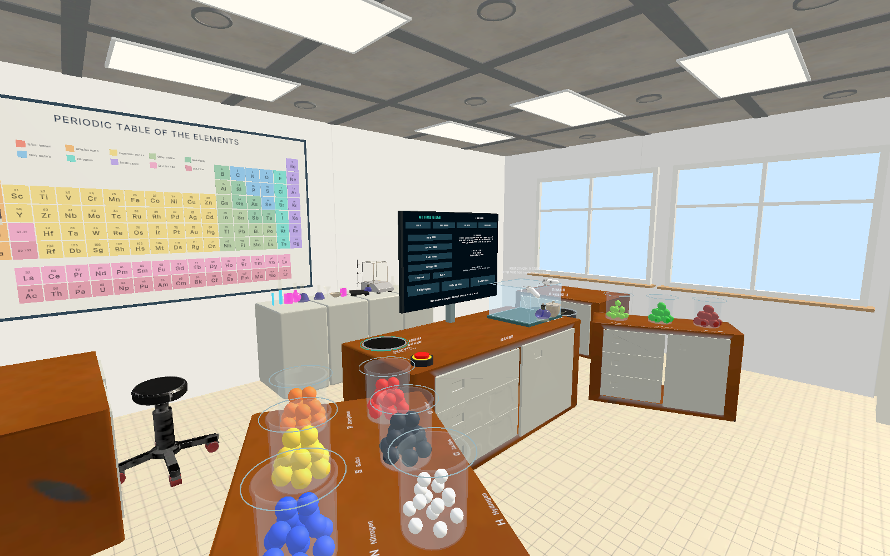

# Molecule Lab VR

A virtual-reality chemistry classroom for **Meta Quest 3**, built in Unity. Students pick atoms out of beakers, snap them
together into molecules with their hands or controllers, inspect the shapes, react them at a reaction table, and keep the
molecules they make in a gallery.

## Getting started

1. Install **Unity 6000.6.2f1** through Unity Hub, with **Android Build Support** (needed for the Quest).
2. In Unity Hub choose **Add > Add project from disk** and select this folder (the one containing `Assets` and `ProjectSettings`).
3. Open the project. The **first import takes a while** (often 10-20 minutes) because Unity builds its `Library` cache; later opens are fast.
4. In the **Project** window go to **`Assets/Scenes`** and double-click **`MoleculeLab`** to load the scene.
5. Press **Play**.

> Make sure the `MoleculeLab` scene is the one that is open: other scenes in the project are templates and do not contain the lab.

The classroom is built by code when the scene runs. Outside Play mode the editor shows a preview of it (marked
*editor only, not saved* in the Hierarchy); **Molecule Lab > Show new design in edit mode** turns that preview off if you
need to edit the original environment.

### Playing in the headset

- **Quest Link / Air Link:** connect the Quest to the PC, then press Play in Unity.
- **Standalone app:** **Molecule Lab > Build Quest APK** writes `Builds/MoleculeLab-Quest3.apk`; install it on the headset
  (for example with Meta Quest Developer Hub). See [Building for the Quest](Documentation/PROJECT_SUMMARY.md#building-for-the-quest).

## What you can do

| Area | What happens there |
|---|---|
| **Workbench** | Choose a goal on the menu screen: with **Guide spots** the atoms' places are shown; with **Formula only** you work out the structure yourself; **No goal** builds anything. Drop an atom on the paper build mat to start, then add atoms on the teal guide dots and direction rays. **Fill hydrogens**, **Undo last atom** and **Clear structure** are on the menu. |
| **Beakers** | Nine elements (H, C, O, N, S, P, F, Cl, Br) in endless beakers on the side cupboards. |
| **Inspect** | Hold a finished molecule to see its name and geometry on a hologram; ethane can be twisted and bent with the gold and blue orbs, and broken with the energy wand. |
| **Reaction table** | Drop molecules into the glass vessel; the iPad beside it says what each tool would do. The **flame** burns fuels, the **Pd catalyst** adds H2 to C=C bonds, the **acid** adds water or makes esters, and bromine reacts with alkenes on its own. Products are worked out from the molecules' bonding, so it works for molecules you built yourself too. The red button empties the vessel. |
| **Gallery** | Drop a finished molecule in the **GALLERY** hole on the bench to keep it; it appears on the tables in the gallery behind you, with a hologram describing it (from PubChem). Let go of an exhibit over the vessel to react a copy, or over the trash can to remove it. The gallery is saved between sessions. |
| **Settings** | Bench height and reach, sound, effects, hints, direction rays on/off and clearing the gallery. The red **RESET LAB** button on the bench starts over (the gallery is kept). |

Hands and Touch controllers both work: pinch or grip to grab, point and pinch (or pull the trigger) to press menu
buttons, and use the controller thumbstick to teleport.

Molecules built freely are named through **PubChem** when the headset or PC is online; everything else works offline.

## Project layout

| Path | Contents |
|---|---|
| `Assets/Scenes/MoleculeLab.unity` | The scene to open and play. |
| `Assets/MoleculeLab/Runtime` | Game code: building, chemistry and reaction rules, the classroom, gallery and reaction table. |
| `Assets/MoleculeLab/Editor` | Editor tools (the **Molecule Lab** menu): Quest set-up and build, content and preview tools. |
| `Assets/MoleculeLab/Tests` | Automated tests (Window > General > Test Runner > EditMode). |
| `Assets/3D Laboratory Environment with Appratus` | Furniture, glassware and room models used for the classroom. |
| `Documentation` | Guides, screenshots and reports. |

## Tests

Open **Window > General > Test Runner**, choose **EditMode** and run **MoleculeLab.Tests**. The chemistry and reaction
tests finish in seconds; the playthrough tests enter Play mode and take a few minutes.

## More documentation

- [Project summary](Documentation/PROJECT_SUMMARY.md): how the lab works, the chemistry, the code layout, building for the Quest and tests.
- [Screenshots](Documentation/Classroom) of the classroom, reaction table and gallery.

## Credits

- Room furniture and glassware: *3D Laboratory Environment with Apparatus* (Unity Asset Store, used under the Asset Store licence).
- Handwriting font: *Patrick Hand* (SIL Open Font License, `Assets/MoleculeLab/Resources/Fonts`).
- Molecule names, 3D shapes and descriptions: [PubChem](https://pubchem.ncbi.nlm.nih.gov/) (U.S. National Library of Medicine).
